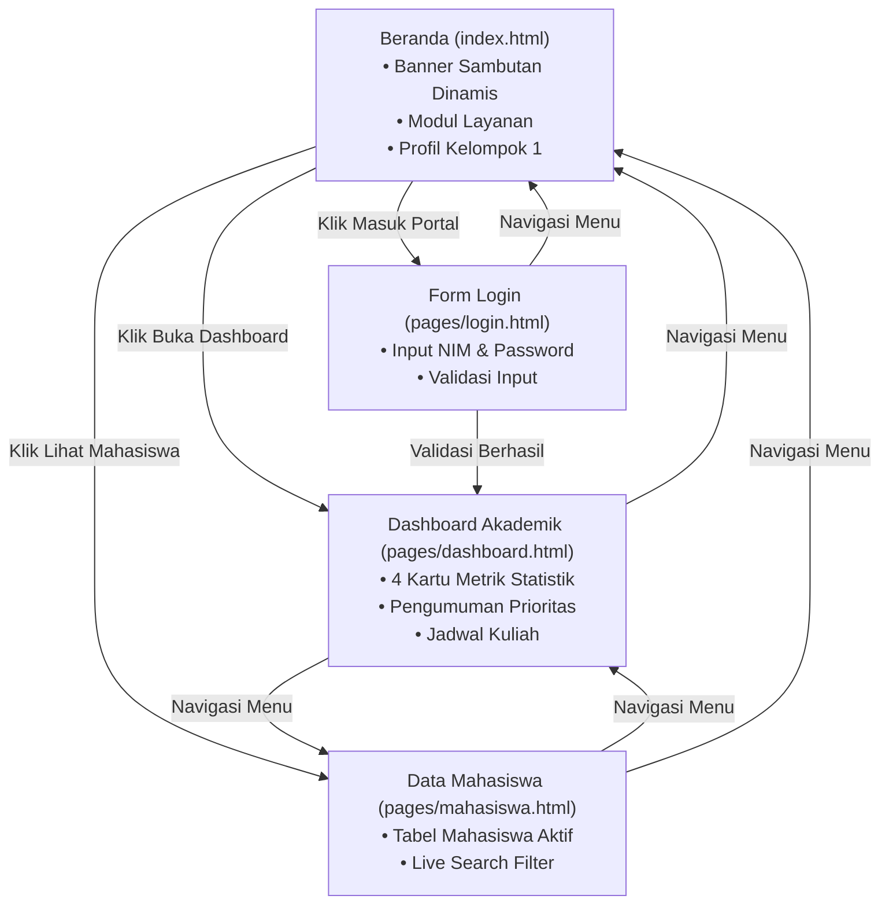

# 🎓 Collaborative Academic Information System (CAIS)
### Proyek Pengembangan Prototype Frontend Terintegrasi — Kelompok 1 (Kelas A / Semester 7)
*Evaluasi Tengah Semester (UTS) Mata Kuliah Collaborative Computing & Academic Information Systems*

---

## 📑 Daftar Isi
1. [Deskripsi Aplikasi](#-deskripsi-aplikasi)
2. [Fitur-Fitur Utama](#-fitur-fitur-utama)
3. [Anggota Kelompok & Rincian Kontribusi](#-anggota-kelompok--rincian-kontribusi)
4. [Struktur Folder & Berkas](#-struktur-folder--berkas)
5. [Panduan Menjalankan Prototype](#-panduan-menjalankan-prototype)
6. [Demonstrasi Alur Aplikasi (User Flow)](#-demonstrasi-alur-aplikasi-user-flow)
7. [Proses Kolaborasi Tim Melalui GitHub](#-proses-kolaborasi-tim-melalui-github)

---

## 📖 Deskripsi Aplikasi

**CAIS (Campus Academic Information System)** adalah prototipe sistem informasi akademik kampus berbasis web yang dirancang untuk memfasilitasi mahasiswa dan pengelola akademik dalam mengakses data perkuliahan, ringkasan statistik akademik, serta direktori mahasiswa secara terpadu.

Aplikasi ini dikembangkan secara kolaboratif menggunakan arsitektur antarmuka murni (**Vanilla HTML5, CSS3, dan JavaScript**) dengan penekanan pada:
- **Clean Architecture & Separation of Concerns**: Pemisahan tegas antara struktur dokumen (`.html`), tata letak dan visual terpusat (`css/style.css`), serta logika interaktif dan validasi (`js/app.js`).
- **Navigasi Global Terpadu**: Kemampuan berpindah antarhalaman secara mulus dan konsisten, baik dari direktori utama (*root*) maupun dari subdirektori modul (`pages/`).
- **Responsive Design**: Antarmuka adaptif yang nyaman diakses melalui perangkat desktop, tablet, maupun layar ponsel pintar.

---

## ✨ Fitur-Fitur Utama

Sistem ini memenuhi seluruh kualifikasi fungsional minimal dan dilengkapi peningkatan modul antarmuka:

### 1. 🏠 Beranda Terintegrasi (`index.html`)
- **Judul dan Hero Banner**: Menampilkan identitas resmi portal CAIS Semester 7 beserta sambutan personal berbasis waktu secara otomatis (*Selamat Pagi / Siang / Sore / Malam*).
- **Akses Cepat (*Quick Action Buttons*)**: Tombol langsung untuk menuju Dashboard Akademik, Direktori Mahasiswa, atau Portal Login.
- **Kartu Layanan Modul**: Penjelasan singkat setiap modul yang tersedia di dalam prototipe.
- **Profil Tim Pengembang**: Transparansi pembagian tugas anggota kelompok.

### 2. 🔐 Form Autentikasi / Login Sederhana (`pages/login.html`)
- **Desain Kartu Elegan**: Form login terpusat dengan input NIM/Email dan Kata Sandi.
- **Validasi Frontend Mandiri (`js/app.js`)**:
  - Pengecekan kolom kosong secara instan dengan notifikasi visual merah (*alert error*).
  - Pengecekan panjang minimal karakter kata sandi (minimal 4 karakter).
  - Simulasi autentikasi berhasil dengan notifikasi hijau (*alert success*), penguncian tombol submit, dan pengalihan otomatis (*auto-redirect*) ke halaman Dashboard.
- **Navigasi Balik**: Pengguna dapat dengan mudah kembali ke Beranda atau modul lainnya kapan saja.

### 3. 📊 Dashboard Informasi Akademik (`pages/dashboard.html`)
- **Kartu Statistik Kunci**:
  - *Total Mahasiswa Aktif*: 142 Mahasiswa
  - *Mata Kuliah Semester Ini*: 6 Mata Kuliah
  - *Rata-Rata IPK*: 3.68
  - *Total SKS Diambil*: 20 SKS
- **Papan Pengumuman Akademik**: Dilengkapi penanda prioritas (`PENTING`, `PERHATIAN`, `INFO`) terkait UTS, batas revisi KRS, dan verifikasi profil mahasiswa.
- **Tabel Jadwal Perkuliahan**: Rincian waktu, kode matkul, nama kuliah, ruangan, dan dosen pengampu hari ini.

### 4. 👥 Tabel Data Mahasiswa (`pages/mahasiswa.html`)
- **Daftar Mahasiswa Aktif**: Menampilkan data anggota kelompok dengan atribut lengkap: Nomor, NIM, Nama Lengkap, Program Studi, Semester, dan Status Keaktifan.
- **Live Search & Filter**: Kolom pencarian instan yang menyaring baris data mahasiswa berdasarkan Nama atau NIM tanpa memuat ulang (*reload*) halaman.
- **Status Badge**: Label visual status keaktifan mahasiswa (*Aktif*).

### 5. 🎨 Styling & Interaktivitas Terpisah
- **`css/style.css`**: Sistem desain global dengan palet warna biru akademik modern (`#1e3a8a`), grid layout responsif, komponen form, kartu statistik, dan tipografi standar industri.
- **`js/app.js`**: Skrip interaktivitas untuk *active navigation highlighter*, validasi formulir login, dan fungsi filter pencarian tabel.

---

## 👥 Anggota Kelompok & Rincian Kontribusi

Pengembangan antarmuka dibagi secara adil dan paralel dengan matriks tanggung jawab sebagai berikut:

| No | Foto / Inisial | Nama Anggota | NIM | Modul Utama | Kontribusi Spesifik |
| :-: | :-: | :--- | :---: | :--- | :--- |
| 1 | **AR** | **Agiel Ramadhan Putra** *(Project Lead)* | **11523001** | Halaman Utama (`index.html`) & Integrasi | Merancang arsitektur Beranda, menghubungkan seluruh jalur navigasi berkas, konfigurasi git remote & branching, integrasi merge ke `main`, dan dokumentasi `README.md`. |
| 2 | **MF** | **Muhammad Faiz Hanifah** | **11523066** | Form Login (`pages/login.html`) | Merancang struktur kartu form login, input username/password, integrasi tombol masuk, serta pengujian form login. |
| 3 | **MY** | **Muhamad Yusuf** | **11523009** | Dashboard Akademik (`pages/dashboard.html`) | Merancang grid ringkasan statistik akademik, papan pengumuman prioritas, dan tabel jadwal perkuliahan harian. |
| 4 | **MR** | **Muhamad Rizki Saputra** | **11523051** | Styling & Skrip (`css/style.css`, `js/app.js`) | Membangun stylesheet global terpusat (CSS reset, layout grid, kartu, tabel, responsive breakpoints), validasi login, dan search filter interaktif. |

---

## 📁 Struktur Folder & Berkas

Berikut adalah hierarki berkas repositori yang telah diintegrasikan:

```text
UTS-CAIS-A-SEMESTER7-KELOMPOK-1/
│
├── css/
│   └── style.css            # Berkas CSS global terpusat (Navbar, Hero, Grid, Form, Tabel, Footer)
│
├── js/
│   └── app.js               # Berkas JavaScript mandiri (Validasi login, filter pencarian, active nav)
│
├── pages/
│   ├── dashboard.html       # Halaman Dashboard (Metrik statistik & pengumuman akademik)
│   ├── login.html           # Halaman Form Login pengguna
│   └── mahasiswa.html       # Halaman Direktori Tabel Mahasiswa Aktif + fitur pencarian
│
├── index.html               # Halaman Beranda utama (Landing page & entry point sistem)
├── login.html               # Entry point alternatif untuk akses langsung dari root
└── README.md                # Dokumentasi komprehensif proyek & panduan kolaborasi
```

---

## 🚀 Panduan Menjalankan Prototype

Tidak diperlukan instalasi package manager atau backend runtime (seperti Node.js atau PHP). Ikuti langkah mudah berikut:

### Langkah 1: Kloning Repositori
Buka terminal/PowerShell di komputer lokal Anda, lalu jalankan:
```bash
git clone https://github.com/agielramdp/UTS-CAIS-A-SEMESTER7-KELOMPOK-1.git
cd UTS-CAIS-A-SEMESTER7-KELOMPOK-1
```

### Langkah 2: Menjalankan di Peramban Web (Browser)
Tersedia dua opsi untuk membuka prototipe:
- **Opsi A (Langsung tanpa alat tambahan)**:
  Buka penjelajah berkas (*File Explorer*), lalu klik ganda pada file `index.html`. Berkas akan langsung terbuka di browser pilihan Anda (Google Chrome, Microsoft Edge, Mozilla Firefox, dll).
- **Opsi B (Menggunakan VS Code Live Server)**:
  1. Buka folder repositori di **Visual Studio Code**.
  2. Klik kanan pada `index.html` &rarr; Pilih **Open with Live Server**.
  3. Aplikasi akan aktif di alamat `http://127.0.0.1:5500/index.html`.

---

## 🔄 Demonstrasi Alur Aplikasi (User Flow)

Alur penjelajahan prototipe CAIS dirancang terhubung dua arah (*bi-directional navigation*):



### Skenario Pengujian Alur:
1. **Pengguna masuk ke `index.html`**:
   Melihat judul aplikasi, ucapan salam sesuai jam saat ini, dan gambaran modul sistem.
2. **Pengguna menuju `pages/login.html`**:
   - Jika tombol **Masuk** ditekan saat isian kosong atau password < 4 huruf &rarr; muncul kotak peringatan merah.
   - Jika form diisi dengan benar (misal: NIM `11523001` dan Password `admin`) &rarr; muncul notifikasi hijau dan sistem mengarahkan otomatis ke Dashboard setelah 1.2 detik.
3. **Pengguna berada di `pages/dashboard.html`**:
   Melihat statistik akademik semester 7, pengumuman jadwal UTS, dan tabel kelas hari ini.
4. **Pengguna beralih ke `pages/mahasiswa.html`**:
   Melihat tabel anggota kelas/kelompok. Pengguna mengetik nama (misal *"Agiel"* atau *"Faiz"*) pada kolom pencarian &rarr; tabel langsung menyaring baris secara instan.

---

## 🌿 Proses Kolaborasi Tim Melalui GitHub

Pengembangan prototipe ini dilakukan secara paralel dengan menerapkan kaidah kolaborasi perangkat lunak berbasis Git:

### 1. Strategi Pencabangan (*Branching Strategy*)
Setiap anggota mengerjakan modul tugasnya pada branch fitur masing-masing agar tidak mengganggu integritas branch `main`:
- `main` : Cabang produksi yang stabil dan terintegrasi penuh.
- `feature-login` : Cabang kerja modul form login.
- `feature-dashboard` : Cabang kerja modul dashboard akademik.
- `feature-mahasiswa` : Cabang kerja modul tabel data mahasiswa.
- `feature-styling` : Cabang pengembangan stylesheet dan interaktivitas JS.

### 2. Siklus Kerja Paralel Tim
```text
(1. Clone / Pull) ────► (2. Buat Branch Fitur) ────► (3. Koding & Commit)
                                                               │
(6. Merge ke Main) ◄─── (5. Pull Request & Review) ◄─── (4. Push Branch)
```

1. **Sinkronisasi Awal**:
   Seluruh anggota menarik versi terbaru dari cabang utama:
   ```bash
   git pull origin main
   ```
2. **Pembuatan Branch Fitur**:
   ```bash
   git checkout -b feature-nama-modul
   ```
3. **Penyimpanan Perubahan Terarah**:
   ```bash
   git add .
   git commit -m "feat: implementasi antarmuka modul"
   ```
4. **Pengiriman ke Repositori Daring**:
   ```bash
   git push origin feature-nama-modul
   ```
5. **Pull Request (PR) & Code Review**:
   Membuat PR di GitHub, meninjau kesesuaian jalur tautan (*path*) CSS/JS, dan memastikan tidak ada kode yang saling menimpa.
6. **Integrasi (Merge)**:
   Setelah disetujui, branch digabungkan ke `main` dan diverifikasi fungsinya secara menyeluruh.

---

## 📄 Lisensi & Hak Cipta
Proyek ini dibuat untuk keperluan akademis **Evaluasi Tengah Semester (UTS) CAIS Kelas A Semester 7 Tahun Akademik 2026/2027** oleh **Kelompok 1**.
Semua kode sumber bersifat terbuka untuk kepentingan pembelajaran.
